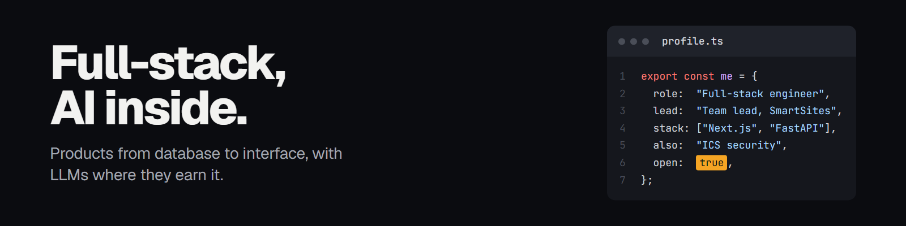

I build full-stack products end to end: **React / Next.js / TypeScript** on the front, **Python / FastAPI** and **PostgreSQL** behind it, and AI or computer vision where it earns its place.

Software Engineering Team Lead at **SmartSites** (AI construction-site monitoring), co-founder and tech lead of **ManteeQ** (Arabic pronunciation coach), and a Control & Automation Engineering student at Yıldız Technical University, where my graduation research is on ICS security.

[Portfolio](https://abduelmorsi.com.tr) · [LinkedIn](https://linkedin.com/in/abduelmorsi) · [Email](mailto:contact@abduelmorsi.com.tr) · Istanbul, remote (UTC+3)

## Selected work

**[Quran Shortly](https://quranshortly.abduelmorsi.com.tr)** · [source](https://github.com/abduelmorsi/quran_shortly)
Renders HD recitation videos for Shorts, Reels and TikTok entirely in the browser, with React and the Canvas API.

**ManteeQ** · [manteeq.com.tr](https://manteeq.com.tr)
Arabic pronunciation coach: Wav2Vec forced alignment over WebSockets for sub-500ms phonetic feedback. Selected for the ETKİM Yıldızları Acceleration Program.

**ICS digital twin**, graduation research
Real-time digital twin (Next.js, Three.js, Modbus TCP, OPC UA) benchmarking five unsupervised models against IEC 62443-aligned attacks. Best result: 71.6% F1 on stealthy ±2.5σ sensor spoofing.

**[PardusGuard](https://github.com/abduelmorsi/pardusguard)**
System hardening and security assessment for Pardus Linux: six scan engines, risk scoring, one-click fixes, GTK4 dashboard. TEKNOFEST 2026.

**[Championship forecaster](https://github.com/abduelmorsi/championship-forecaster)**
Football league simulator in Go and SQLite: Poisson match engine and 10,000-run Monte Carlo title odds, with an interactive dashboard.

**[FitSense AI](https://github.com/abduelmorsi/nighquest-fitsense-ai)**
Smartphone IMU signal processing and BiLSTM activity classification (95.8%) in MATLAB. 2nd place, MathWorks BEST Istanbul Hackathon.

**[Prompt-driven design system](https://github.com/abduelmorsi/prompt-design-system-starter)**
Describe a post in one sentence, get an on-brand image and caption from an AI coding agent. The kit behind the banner above. [Write-up](https://abduelmorsi.com.tr/articles/prompt-driven-design-system).

## Stack

**Product:** TypeScript, React, Next.js, Astro, Tailwind CSS, Node.js, Python, FastAPI, PostgreSQL, Docker, Cloudflare Workers
**AI:** OpenAI API, LangChain, RAG, Wav2Vec, OpenCV, XGBoost, PyTorch
**Industrial and security:** Modbus TCP, OPC UA, Siemens S7, Omron and Phoenix Contact PLCs, MATLAB / Simulink, Wireshark, Nmap

---

Open to remote full-stack and AI integration roles. If something here is useful, you can [buy me a coffee](https://coff.ee/abduelmorsi).
